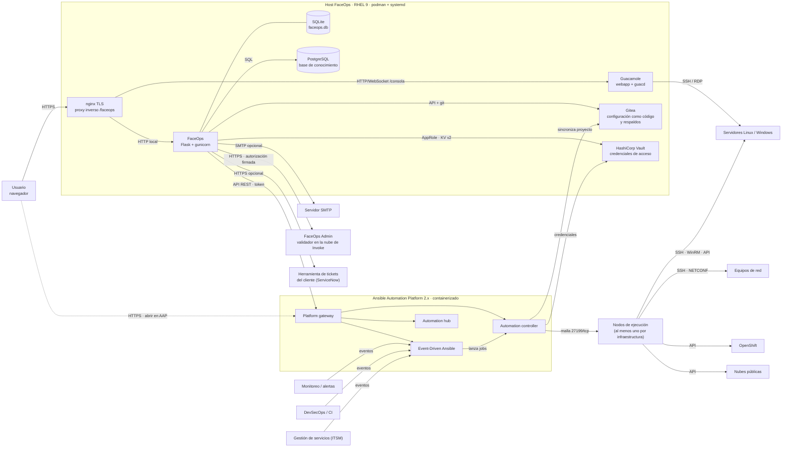

# FaceOps · Guía técnica de instalación

FaceOps es la consola del Managed Service de Invoke sobre Red Hat Ansible Automation Platform (AAP). Esta guía cubre la instalación en infraestructura del cliente con el playbook de `faceops/instalacion/playbook` y el empaquetado automático de `faceops/instalacion/ci`.

## 1. Arquitectura



| Componente | Rol |
|---|---|
| nginx | Termina TLS, publica la consola bajo el prefijo `/faceops` y Guacamole en `/consola/`. |
| FaceOps (Flask + gunicorn, podman) | Consola: catálogo de automatizaciones, tickets y aprobaciones, inventario inteligente, gobierno (segmentos, skills, políticas) y FaceOps-admin (`/faceops/admin/`: clientes, usuarios, tarifas). Un proceso de fondo (vigía) sincroniza tickets, jobs e inventario. |
| SQLite | Base de datos operativa de FaceOps (clientes, usuarios, tickets, auditoría). Un solo archivo en el volumen de datos. |
| AAP · controller | Ejecuta las automatizaciones; FaceOps lanza plantillas y workflows por API con el token del usuario de servicio. |
| Nodos de ejecución | Al menos uno por infraestructura (y por ambiente/segmento de red): ejecutan las automatizaciones desde dentro del segmento que tocan; en nubes, detrás de un nodo hop. Solo abren la malla 27199/tcp hacia el plano de control. |
| AAP · EDA | Recibe alertas (webhooks de monitoreo, certificados, OpenShift) y lanza jobs; FaceOps lee sus activaciones y eventos. |
| AAP · hub / Galaxy | Colecciones y execution environments del proyecto de FaceOps. |
| Gitea | Publicado también por el HTTPS de FaceOps en `/git/`. Repositorios de configuración como código (estado de servidores, red, arquitectura aprobada), respaldo continuo (una rama por servidor) y el repositorio `invoke/faceops-automatizaciones` que sincroniza AAP. |
| HashiCorp Vault | Obligatoria (la edición Community sirve). Credenciales de acceso por equipo (`faceops/maquinas/<equipo>`, `faceops/web/<equipo>`) conectadas a AAP; FaceOps solo lee, con AppRole. Las máquinas sin credencial se vinculan con la automatización «FaceOps · Vincular máquina a la bóveda». |
| PostgreSQL (KB) | Base de conocimiento de incidentes: problemas conocidos por producto y versión, patrones y automatización que los resuelve. |
| Guacamole (opcional) | Consola SSH/RDP en el navegador. FaceOps entrega una conexión firmada, cifrada y de un solo uso; el navegador no ve la llave. |
| SMTP (opcional) | Avisos e informes por correo. |
| Aprobaciones | Toda automatización pide una o más aprobaciones por área (en serie o en paralelo), como nodos de aprobación de AAP sin vencimiento. |
| FaceOps Admin (nube de Invoke) | Validador: ninguna automatización llega a AAP sin una autorización firmada vigente. Sin respuesta del validador, no se lanza nada. |
| Herramienta de tickets (opcional) | ServiceNow u otra del cliente, configurada por cliente en FaceOps-admin. |

## 2. Recursos mínimos

Capacidad expresada en **cores físicos**. AAP según la topología *growth* containerizada de Red Hat (un host); el resto son estimaciones de Invoke para la carga de un cliente del Managed Service.

### 2.1 Por componente

| Componente | Cores físicos (mín.) | RAM (mín.) | Disco (mín.) | Cores físicos (recom.) | RAM (recom.) | Disco (recom.) |
|---|---|---|---|---|---|---|
| AAP 2.6 containerizado, growth ¹ | 2 | 16 GB | 60 GB | 4 | 32 GB | 100 GB |
| FaceOps (contenedor + vigía) | 1 | 2 GB | 10 GB | 2 | 4 GB | 20 GB |
| Gitea | 0,5 | 1 GB | 20 GB | 1 | 2 GB | 50 GB |
| Vault | 0,5 | 0,5 GB | 5 GB | 1 | 1 GB | 10 GB |
| PostgreSQL KB | 1 | 2 GB | 10 GB | 2 | 4 GB | 20 GB |
| Guacamole (opcional) | 0,5 | 1,5 GB | 5 GB | 1 | 2 GB | 5 GB |
| nginx | compartido | 0,5 GB | 1 GB | compartido | 0,5 GB | 1 GB |
| Sistema operativo (host FaceOps separado) | 1 | 2 GB | 20 GB | 1 | 2 GB | 20 GB |

¹ Red Hat publica 4 vCPU, 16 GB de RAM (32 GB en instalación *bundled* con `hub_seed_collections=true`), 60 GB de disco y 3000 IOPS; RHEL 9.6+ o RHEL 10. Los 4 vCPU equivalen a 2 cores físicos con SMT 2:1. Ver [System requirements](https://docs.redhat.com/fr/documentation/red_hat_ansible_automation_platform/2.6/install-ref_cont_aap_system_requirements) y [Container growth topology](https://docs.redhat.com/en/documentation/red_hat_ansible_automation_platform/2.6/plan-ref_cont_a_env_a).

### 2.2 Totales

| Escenario | Host | Cores físicos | RAM | Disco |
|---|---|---|---|---|
| Un host (mínimo, con Guacamole) | AAP + FaceOps | 6 | 24 GB | 120 GB |
| Un host (recomendado) | AAP + FaceOps | 12 | 48 GB | 220 GB |
| Separado (recomendado) | Host AAP | 4 | 32 GB | 100 GB |
| Separado (recomendado) | Host FaceOps | 8 | 16 GB | 150 GB |
| Separado (mínimo) | Host AAP | 2 | 16 GB | 60 GB |
| Separado (mínimo) | Host FaceOps | 5 | 12 GB | 80 GB |

La instalación separada es la recomendada para producción: AAP queda con el dimensionamiento soportado por Red Hat y sin conflictos de puertos.

## 3. Puertos y flujos de red

| Origen | Destino | Puerto / protocolo | Uso |
|---|---|---|---|
| Usuarios | nginx (host FaceOps) | 8843/tcp HTTPS (`faceops_puerto_publico`) | Consola `/faceops` y consola web `/consola/` |
| Usuarios | Gateway AAP | 443/tcp HTTPS | Enlaces "abrir en AAP" y aprobaciones nativas |
| nginx | FaceOps | 127.0.0.1:8110/tcp HTTP | Proxy inverso |
| nginx | Guacamole | 127.0.0.1:8111/tcp HTTP + WebSocket | Consola SSH/RDP |
| FaceOps | Gateway AAP | 443/tcp HTTPS | API controller (`/api/controller/v2`) y EDA (`/api/eda/v1`) |
| FaceOps | Gitea | 3000/tcp HTTP | API y lectura de commits |
| FaceOps | Vault | 8200/tcp HTTP/HTTPS | AppRole y lectura KV |
| FaceOps | PostgreSQL KB | 127.0.0.1:5433/tcp | Base de conocimiento |
| FaceOps | SMTP | 587/tcp STARTTLS | Correo (opcional) |
| FaceOps | FaceOps Admin (Internet) | 443/tcp HTTPS | Autorización de cada automatización |
| FaceOps | Herramienta de tickets | 443/tcp HTTPS | Integración de tickets (opcional) |
| FaceOps | Equipos con Redis / Redis Insight | 6379/tcp, 5540/tcp | Consola Redis y proxy de Redis Insight (si el cliente los usa) |
| AAP controller | Gitea | 3000/tcp HTTP | Sincronización del proyecto |
| AAP controller / hub | Galaxy, Automation Hub, registry.redhat.io | 443/tcp HTTPS | Colecciones y execution environments |
| AAP (execution environment) | Servidores Linux / equipos de red | 22/tcp SSH, 830/tcp NETCONF | Automatización |
| AAP (execution environment) | Servidores Windows | 5986/tcp WinRM HTTPS (5985 HTTP) | Automatización |
| AAP (execution environment) | OpenShift | 6443/tcp HTTPS | API del clúster |
| AAP (execution environment) | Nubes públicas | 443/tcp HTTPS | API de cada proveedor |
| Monitoreo / alertas | AAP EDA | 5020/tcp, 5021/tcp (rulebooks de certificados y OpenShift) | Webhooks hacia las activaciones |
| guacd | Servidores | 22/tcp SSH, 3389/tcp RDP | Consola web |
| Host FaceOps | registry.redhat.io, docker.io, registro de Invoke | 443/tcp HTTPS | Imágenes de contenedores |
| Puertos internos de AAP | — | ver documentación de Red Hat (topología growth) | 5432, 6379, 8443, 27199 y puertos NGINX de cada servicio |

## 4. Prerrequisitos

| Ítem | Detalle |
|---|---|
| Sistema operativo | RHEL 9 registrado (RHEL 9.6+ si AAP comparte el host), SELinux en enforcing, acceso a los repositorios BaseOS y AppStream. |
| Suscripciones | Red Hat Ansible Automation Platform; RHEL. Cuenta de registry.redhat.io (imagen de PostgreSQL). |
| AAP | Instalado con el instalador containerizado de Red Hat, con URL del gateway y cuenta administradora (o un token de un usuario de servicio creado por el cliente). |
| DNS | Registro para FaceOps (`faceops_fqdn`) resoluble por usuarios y por AAP (AAP clona Gitea por ese nombre). |
| Certificado | Certificado TLS para `faceops_fqdn` con su cadena, y la CA interna si AAP, Vault o Gitea usan certificados privados. |
| Cuentas | Usuario con sudo en el host FaceOps y acceso SSH desde el nodo de control; código de enrolamiento de FaceOps Admin (lo entrega Invoke). |
| Salida a Internet | Hacia el validador de FaceOps Admin y los registros de imágenes (o un registro espejo). |
| Nodo de control | ansible-core 2.16+ con las colecciones de `playbook/collections/requirements.yml` (ansible.controller desde Automation Hub). |

## 5. Instalación

1. **Obtener el paquete.** Descargar `faceops-instalador-<versión>.tar.gz` del pipeline (sección 9) y descomprimir; o usar el repositorio en la carpeta `faceops/`.
2. **Colecciones.**
   ```bash
   cd faceops/instalacion/playbook
   ansible-galaxy collection install -r collections/requirements.yml
   ```
3. **Inventario.** Copiar `inventario/hosts.yml.ejemplo` a `inventario/hosts.yml` con el host FaceOps.
4. **Parámetros.** Ajustar `group_vars/faceops/main.yml` (cada parámetro está comentado): FQDN, puerto público, componentes a instalar, origen de la imagen (`registro` o `fuente`), URL de AAP, repositorios de Gitea y capas de configuración como código.
5. **Certificado.** Dejar `faceops.crt` y `faceops.key` en `playbook/files/` (o ajustar `faceops_tls_cert_local` / `faceops_tls_key_local`).
6. **Secretos.**
   ```bash
   cp group_vars/faceops/vault.yml.ejemplo group_vars/faceops/vault.yml
   vi group_vars/faceops/vault.yml
   ansible-vault encrypt group_vars/faceops/vault.yml
   ```
7. **Prueba en seco** (útil sobre un host ya instalado; en la primera instalación varias tareas dependen de servicios que aún no existen y se omiten):
   ```bash
   ansible-playbook -i inventario/hosts.yml instalar.yml --ask-vault-pass --check --diff
   ```
8. **Instalar.**
   ```bash
   ansible-playbook -i inventario/hosts.yml instalar.yml --ask-vault-pass
   ```
   Etiquetas disponibles para ejecutar por partes: `prerrequisitos`, `gitea`, `vault`, `kb`, `guacamole`, `aap`, `faceops`, `nginx`.
9. **Vault.** La primera ejecución inicializa Vault y deja llaves de desellado y token raíz en `/root/faceops-vault-init.json`. Copiar las llaves a custodia del cliente (fuera del host), revocar o guardar el token raíz y borrar el archivo. Desde ahí, tras cada reinicio de Vault se desella a mano (`podman exec -it vault vault operator unseal`) o se configura auto-unseal (KMS, HSM o Transit), recomendado en producción.
10. **Credenciales iniciales.** FaceOps deja las claves iniciales de los usuarios en `/var/lib/faceops/credenciales-iniciales.txt` (leer con sudo, entregar y eliminar).

Qué hace cada rol:

| Rol | Resultado |
|---|---|
| prerrequisitos | podman, nginx, git, firewalld con los puertos públicos, CA interna en el trust, login en registry.redhat.io. |
| gitea | Contenedor Gitea (Quadlet `gitea.service`), administrador, organizaciones y repositorios privados, usuario de respaldo y tokens (en `/etc/faceops/secretos`). |
| vault | Contenedor Vault (`vault.service`, raft), inicialización y desellado la primera vez, KV v2 `faceops`, política de solo lectura y AppRole. |
| postgresql_kb | Contenedor PostgreSQL 16 de Red Hat (`faceops-kb.service`) con claves en secretos de podman. FaceOps crea el esquema y carga las semillas al iniciar. |
| guacamole | guacd y webapp (`faceops-guacd`, `faceops-guacamole`) con la clave compartida en un secreto de podman. |
| aap | Usuario de servicio y token, publicación de `faceops/aap` en `invoke/faceops-automatizaciones`, organización, credencial de Git, proyecto y plantillas base. |
| faceops | Imagen (registro o build), `/etc/faceops/faceops.env` (0600), unidad `faceops.service`, capas de configuración como código y enrolamiento con FaceOps Admin. |
| nginx | Sitio TLS en el puerto público con `/faceops` y `/consola/`, etiqueta SELinux del puerto y `httpd_can_network_connect`. |

### 5.1 Variables de entorno de FaceOps

El rol `faceops` genera `/etc/faceops/faceops.env`; no editar a mano (se sobrescribe).

| Variable | Configura |
|---|---|
| `FACEOPS_BD` | Ruta del archivo SQLite. |
| `FACEOPS_PREFIJO` | Prefijo público de la consola. |
| `FACEOPS_URL_PUBLICA` | URL pública (enlaces de invitación de usuarios). |
| `FACEOPS_CLAVE_SESION` | Clave de sesión Flask; si no se define se genera en el volumen de datos. |
| `FACEOPS_ADMIN`, `FACEOPS_ADMIN_NOMBRE` | Primer administrador. |
| `FACEOPS_VIGIA` | Proceso de fondo de sincronización (1/0). |
| `FACEOPS_AAP_URL`, `FACEOPS_AAP_TOKEN` | AAP y token con que se siembra el cliente inicial. |
| `FACEOPS_AAP_PUBLICA` | URL de AAP que abre el navegador. |
| `FACEOPS_GITEA_TOKEN` | Token de Gitea (arquitectura aprobada, repositorios privados). |
| `FACEOPS_RESPALDO_TOKEN` | Token del usuario de respaldo (historial de `repositorio/*`). |
| `FACEOPS_VAULT_ADDR`, `FACEOPS_VAULT_ROLE_ID`, `FACEOPS_VAULT_SECRET_ID` | Vault y AppRole. |
| `FACEOPS_KB_DSN` | Conexión a la base de conocimiento. |
| `FACEOPS_GUAC_CLAVE` | Clave compartida con Guacamole (auth-json). |
| `FACEOPS_LLAVE_SSH` | Llave por defecto de la consola SSH cuando el equipo no tiene credencial en Vault. |
| `FACEOPS_SMTP_HOST`, `_PUERTO`, `_USUARIO`, `_CLAVE`, `_DE` | Correo. |
| `FACEOPS_VALIDADOR_URL`, `FACEOPS_CONFIANZA_DIR` | FaceOps Admin y llaves de la instalación. |
| `FACEOPS_CA_PUBLICA` | URL de la CA interna del panel de certificados. |
| `FACEOPS_INFORMES` | Carpeta de informes PDF (por defecto junto a la base de datos). |

## 6. Verificación posterior

| Verificación | Comando o acción | Resultado esperado |
|---|---|---|
| Servicios | `systemctl is-active faceops nginx gitea vault faceops-kb` | `active` en todos (y Guacamole si aplica) |
| FaceOps local | `curl -s -o /dev/null -w '%{http_code}' http://127.0.0.1:8110/ingresar` | `200` |
| Acceso público | Abrir `https://<faceops_fqdn>:<puerto>/faceops/` | Pantalla de ingreso con certificado válido |
| Vault | `curl -s http://127.0.0.1:8200/v1/sys/seal-status` | `"sealed":false` |
| Gitea | Ingresar con el administrador | Organizaciones y repositorios creados |
| AAP | Proyecto "FaceOps · automatizaciones" | Última sincronización exitosa; plantillas base presentes |
| Enrolamiento | `sudo ls /var/lib/faceops/confianza/instancia.json` | Archivo presente; FaceOps-admin muestra la instancia |
| Catálogo | FaceOps-admin → Clientes → sincronizar catálogo | Automatizaciones de AAP visibles en la consola |
| Prueba de punta a punta | Lanzar "FaceOps · Recolectar inventario" desde FaceOps | Ticket con autorización del validador y job exitoso en AAP |
| Consola web | Abrir SSH a un servidor del inventario | Sesión en el navegador |

## 7. Incorporar un cliente (conexión con AAP)

1. En el AAP del cliente: usuario de servicio con token de escritura (lo crea el rol `aap`, o el cliente si prefiere entregar el token).
2. Inventarios y credenciales de máquinas del cliente en AAP (los define el cliente o Invoke según el contrato).
3. Plantillas restantes (workflows con aprobación, OpenShift, migraciones, storage, nube): **actividad de Invoke** con `faceops/aap/configurar.py` ajustado al cliente.
4. Rulebook activations de EDA (`rulebooks/certificados.yml`, `rulebooks/openshift.yml`) desde el proyecto de FaceOps: **actividad de Invoke**.
5. En FaceOps-admin → Clientes → Nuevo: código, nombre, URL de AAP, token, validación de certificado, herramienta de tickets y moneda/costo hora.
6. Usuarios y perfiles (cliente × segmentos × lectura/escritura × aprobador) y gobierno (segmentos, skills, políticas) en FaceOps-admin.
7. Sincronizar catálogo e inventario; cargar en Vault las credenciales de acceso por equipo (`faceops/maquinas/<equipo>` con `metodo`, `usuario` y `clave` o `llave_privada`).

## 8. Actualización

1. CI publica una imagen nueva con tag de versión y SHA (sección 9).
2. Respaldar (sección 10).
3. Cambiar `faceops_imagen_tag` (o usar el `version.yml` que trae el paquete) y ejecutar:
   ```bash
   ansible-playbook -i inventario/hosts.yml instalar.yml --ask-vault-pass --tags faceops,aap
   ```
   El rol descarga la imagen, regenera la unidad y reinicia el servicio solo si algo cambió; el rol `aap` publica los playbooks nuevos en Gitea y AAP los toma en la próxima sincronización. FaceOps migra su esquema SQLite al iniciar.
4. Verificar con la tabla de la sección 6.
5. Vuelta atrás: restaurar el tag anterior y, si hubo migración de esquema incompatible, el respaldo de SQLite.

## 9. Empaquetado automático (CI)

`ci/faceops-paquete.yml` es un workflow de Gitea Actions (compatible con GitHub Actions). En cada commit a `main` que toca `faceops/` y en cada tag `vX.Y.Z`:

| Paso | Resultado |
|---|---|
| Versión | Tag `vX.Y.Z` → `X.Y.Z`; en `main` → `VERSION_BASE.<número de ejecución>`. |
| Lint | `--syntax-check` y `ansible-lint` del instalador. |
| Imagen | Build de `faceops/Containerfile` con etiquetas OCI de revisión y versión; tags `<SHA corto>` y `<versión>` (`latest` solo en tags). |
| Prueba de humo | El contenedor responde `/ingresar`. |
| Publicación | Push al registro parametrizado (`vars.REGISTRO`, `vars.IMAGEN`, secretos `REGISTRO_USUARIO` / `REGISTRO_CLAVE`). |
| Paquete | `faceops-instalador-<versión>.tar.gz` + `.sha256`: playbook, automatizaciones de AAP, catálogo (`datos/`) y `version.yml` con la imagen exacta. |

Instalación: copiar el archivo a `.gitea/workflows/` (o `.github/workflows/`) y registrar un runner con podman.

## 10. Respaldo y restauración

| Elemento | Respaldo | Restauración |
|---|---|---|
| SQLite de FaceOps | `podman exec faceops python3 -c "import sqlite3; s=sqlite3.connect('/var/lib/faceops/faceops.db'); d=sqlite3.connect('/var/lib/faceops/respaldo.db'); s.backup(d)"` y copiar `respaldo.db` junto con `/var/lib/faceops/confianza/`, `clave-sesion` y `llaves/` | Detener `faceops`, reponer los archivos (dueño 1001:0) y arrancar |
| Configuración | `/etc/faceops/` (entorno, secretos generados, capas) | Reponer y ejecutar el playbook con `--tags faceops` |
| Gitea | `podman exec -u git gitea gitea dump -c /data/gitea/conf/app.ini -f /data/respaldo.zip` | Gitea nuevo con el mismo `faceops_gitea_datos_dir`, descomprimir el dump según la documentación de Gitea |
| Vault | `podman exec -e VAULT_TOKEN=<token> vault vault operator raft snapshot save /vault/file/respaldo.snap` | `vault operator raft snapshot restore -force` sobre un Vault desellado; requiere las llaves de desellado originales |
| PostgreSQL KB | `podman exec faceops-kb pg_dump -Fc faceops_kb > kb.dump` | `pg_restore -c -d faceops_kb` (o volver a sembrar: FaceOps recarga `datos/kb`) |
| AAP | Procedimiento de respaldo del instalador containerizado de Red Hat | Ídem |

Programar los respaldos con una plantilla de AAP o un timer de systemd y llevarlos fuera del host.

## 11. Solución de problemas

| Síntoma | Causa probable | Acción |
|---|---|---|
| 502 en `/faceops/` | Contenedor detenido o enlazado a otra IP | `journalctl -u faceops -n 100`; revisar `faceops_bind` contra `proxy_pass` |
| Enlaces o estilos sin `/faceops` | Falta `X-Forwarded-Prefix` | Revisar `/etc/nginx/conf.d/faceops.conf` |
| nginx no inicia | Puerto 80/443 ocupado por AAP o puerto sin etiqueta SELinux | `ss -ltnp`; `semanage port -l \| grep http_port_t` |
| "El cliente no tiene configurada la conexión con AAP" | Token o URL vacíos | FaceOps-admin → Clientes; probar `curl -H "Authorization: Bearer <token>" <aap>/api/controller/v2/me/` |
| Automatización rechazada sin llegar a AAP | Validador de FaceOps Admin inaccesible o instancia no enrolada | Salida a Internet hacia `FACEOPS_VALIDADOR_URL`; revisar `confianza/instancia.json`; tabla `validaciones_rechazos` |
| Error TLS hacia AAP, Vault o Gitea | CA interna no confiable | Definir `faceops_tls_ca_local` y volver a ejecutar `--tags prerrequisitos,faceops` |
| Proyecto de AAP no sincroniza | AAP no resuelve `faceops_fqdn` o puerto de Gitea cerrado | DNS y firewall; credencial "FaceOps · Gitea" |
| Consola web no abre | Guacamole caído o clave distinta | `systemctl status faceops-guacamole`; repetir `--tags guacamole,faceops` |
| Vault sellado tras reinicio | Comportamiento normal sin auto-unseal | `podman exec -it vault vault operator unseal` (umbral de llaves) |
| Base de conocimiento vacía | DSN incorrecto o PostgreSQL detenido | `systemctl status faceops-kb`; revisar `FACEOPS_KB_DSN` |
| Correo no sale | SMTP sin definir o puerto bloqueado | `FACEOPS_SMTP_HOST` y salida al puerto SMTP |

## 12. Pendientes y supuestos

| Tema | Estado |
|---|---|
| `aap/configurar.py` | Hoy depende de archivos del laboratorio (`~/demo-drift/cicd-secretos.txt`, inventario del bundle, inventarios y llaves de demo). Para clientes debe recibir URL/token de AAP y Gitea por parámetros; mientras tanto, el rol `aap` crea solo las plantillas base. |
| Datos de demostración | En cada arranque FaceOps siembra el cliente "Invoke Lab" (`datos/invoke-lab.yml`) y el administrador con correo de Invoke. Definir una opción para no sembrar demos en clientes. |
| Usuario de servicio en AAP | Se crea como superusuario (igual que el laboratorio). Evaluar un rol con permisos acotados a la organización de FaceOps. |
| Dimensionamiento de FaceOps | Las cifras de los componentes propios son estimaciones; validar con mediciones en el laboratorio. |
| Imagen PostgreSQL | Requiere cuenta de registry.redhat.io; alternativa: PostgreSQL de AppStream en el host. |
| Workflows con aprobación y EDA | Configuración manual o vía `configurar.py` parametrizado (actividad de Invoke). |
